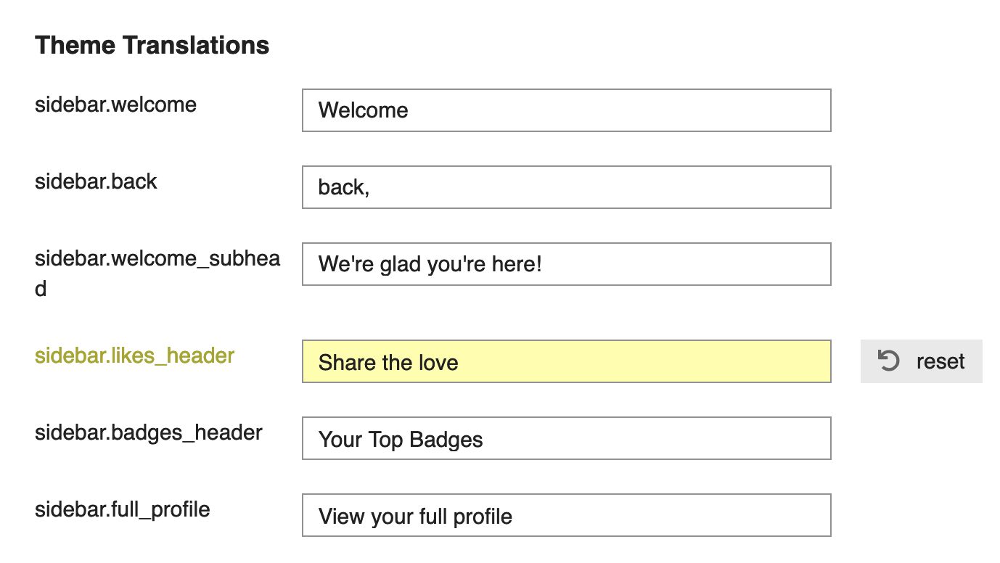

A theme's custom text can come from two places:

- **Locale files** for text that ships with the theme, such as headings, button labels and messages.
- **Object settings** for text that admins enter in the object editor, such as card titles or link labels. See [translatable settings](14a-translatable-settings.md).

Both end up in the same theme translations. Admins translate and customize them in the admin UI, and your code reads them with `themePrefix` and `i18n`.

## Locale files

Add translation files to the theme as `locales/{locale}.yml`, for example `locales/en.yml` or `locales/fr.yml`. Each file is valid YAML with a single top-level key equal to its locale:

```yaml
en:
  theme_metadata:
    description: "This is a description for my theme"
    settings:
      theme_setting_name: "This is a description for the setting `theme_setting_name`"
      another_theme_setting_name:
        description: "This is a description for the setting `another_theme_setting_name`"
  banner:
    welcome: "Welcome to our community"
    subhead: "We're glad you're here!"
    button: "Start a new topic"
    dismiss: "Hide this banner"
```

The `theme_metadata` block holds the theme's description and the descriptions of its settings. See [theme metadata](12-theme-metadata.md) and [theme settings](09-theme-settings.md). All other keys are yours to use in code.

Fallback works as in core. A locale file can be incomplete: any key it doesn't define falls back to English.

## Using translations in code

Translations are stored under a namespace for each theme. Site texts shows them as `js.theme_translations.<theme_id>.<key>`, for example `js.theme_translations.34.banner.welcome`.

Never hardcode the theme ID. Build the key with the `themePrefix` helper:

```gjs
import { i18n } from "discourse-i18n";
import { themePrefix } from "virtual:theme";

// In JS code:
const result = i18n(themePrefix("banner.welcome"));

// In a template tag:
<template>{{i18n (themePrefix "banner.welcome")}}</template>
```

`i18n()` treats `%{name}` as an interpolation placeholder. If you don't pass an argument for it, the output shows `[missing %{name} value]`.

## Managing translations in the admin UI

Admins can translate and customize a theme's strings on the theme's page or in Site texts. Both save the same overrides, so a change made in one shows up in the other. Each installation of a component has its own translations.

### In Theme translations

Open the theme or component in **Appearance → Themes & components**. The **Theme translations** section lists the theme's strings. Choose a language, edit a string, and select **reset** to go back to the shipped text.



When the Discourse AI plugin is enabled, **Translate** next to the language picker generates translations from the selected language into the site's content localization languages.

### In Site texts

In **Appearance → Site texts**, select the theme or component under **Theme or component** to show its strings. The filter can be linked to directly: `/admin/customize/site_texts?theme_id=<theme_id>`.


When you edit an entry, Site texts shows its default text, labelled with the language of that text, next to your translation. For locale files, the default text is the English text if English defines the key; otherwise the selected language's shipped text.

#### Outdated translations

When the default text changes, translations based on the old text are marked **Outdated**, and Site texts shows the old and new default side by side. **Only show outdated/invalid** lists them. Translations saved before Discourse tracked default text show **Unknown baseline** instead; **Acknowledge current default** starts tracking them.

#### Interpolation placeholders

Site texts doesn't check placeholders in locale-file translations, because your code can pass arguments that the shipped text doesn't use.

### Removed keys

Removing a key from a locale file keeps its translations, hidden from the admin UI, so they're used again if the key comes back. Translations are only deleted by **reset** on the theme's page, **Revert to default** in Site texts, or by deleting the theme or component.

## Updating existing components

To turn a plain string setting into a locale-file translation, use `helpers.migrateSettingToTranslation` in a settings migration. See [migrate settings](11-migrate-settings.md).

## Example

For a complete component that uses both locale files and translatable settings, see [discourse-theme-component-i18n-test](https://github.com/nattsw/discourse-theme-component-i18n-test).
