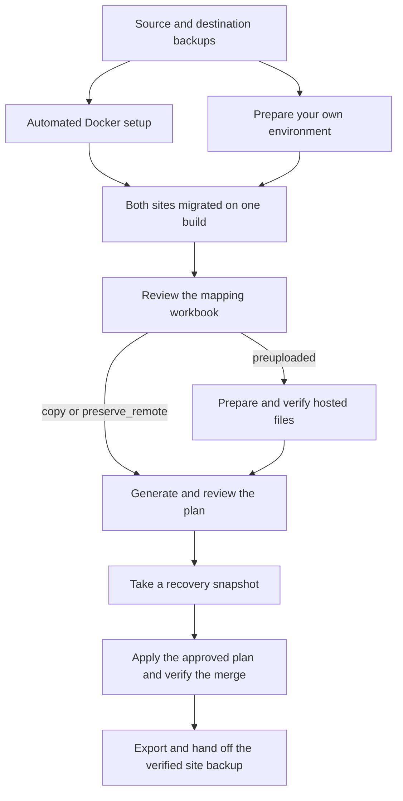

# Merge two Discourse sites

The **source** contributes incoming members and discussions. The **destination** keeps its settings, appearance and existing community. The merger works on restored backups. Posts made after those snapshots will be missing from the rehearsal. For cutover, freeze writes on both live sites and repeat the reviewed workflow with final backups and the intended destination URL.

## What happens to the content?

| Incoming data | What happens | What to review |
| --- | --- | --- |
| Members, profiles and avatars | The source primary email identifies a matching destination account. That account keeps its credentials, profile and roles. Other members get new accounts, with a suffix if a username is taken. A matched member using a default avatar can inherit the source’s public avatar. | Check account matches, renamed users and whether new accounts should keep source staff roles. |
| Categories, topics and posts | Category rules create, reuse or exclude categories and route discussions. Replies, authors, revisions and likes follow the retained topics. Topics with similar titles stay separate. | Check category paths, exclusions and individual topic exceptions in the workbook. |
| Groups, private messages and restricted content | Custom groups can be copied or combined. Included private messages keep their mapped participants. Restricted categories carry access rules for the mapped groups. | Combining memberships can give people new access. Review those changes explicitly. Private messages are included by default. |
| Tags and activity | Tags and topic associations can be imported. For matched members the merger combines visit history, accounts for overlapping days and updates activity summaries. | Decide whether to import tags. Check a matched member’s Summary on the restored site. |
| Attachments and thumbnails | Upload references follow the mapped posts and files. The upload mode determines where the bytes are served. | Test an incoming image and thumbnail, a retained download and access to private media. |
| Profile fields, translations, emoji and published pages | Compatible fields and translations are carried over. A custom emoji name collision keeps the destination artwork. Published pages can keep available paths. | Review skipped values and path conflicts in the plan. |
| Links and plugin data | Supported links are rewritten for the destination. The merger produces a topic redirect map for the old host. Features with explicit support, such as solved answers and polls, follow their discussions. | Forwarding old bookmarks requires deploying the map on the old domain. Read the preview for omitted content. Preflight stops on known unsupported active data that needs an adapter. |

## Where will uploads live?

| Mode | When files move | What must remain available |
| --- | --- | --- |
| `copy` | Apply copies incoming local files into destination storage. | Supply the source originals and writable local destination storage. Export a full backup for restore. |
| `preserve_remote` | The merger keeps remote references and leaves the files on their existing hosts. | Keep those origins serving the files. Planning checks references and metadata. Test actual downloads on restore. |
| `preuploaded` | A preparation step verifies hosted files and writes missing objects to S3 before planning. It can stage both sites’ files or stage incoming files while retaining the destination’s current prefix. | The SQL-only export depends on the configured media locations, CDN and access policy. Test both incoming and retained files. |

## What you get

The **workbook** records your choices. The **preview** shows what those choices will do before you approve a plan. After a verified apply, the **reports** summarize the merge and account outcomes. Restoring the **exported backup** lets you check what members will see before deciding on production cutover.

Start with [automated Docker setup](MERGE-DOCKER.md#automated-docker-setup) or [bring your own environment](MERGE-DOCKER.md#bring-your-own-environment). Both paths use the same workbook and merger CLI.

**Developer testing.** From the checkout root, `script/bulk_import/discourse_merger/review-fixture IMAGE` runs a synthetic merge, report and restore test in a disposable container using the pinned local all-in-one image.
